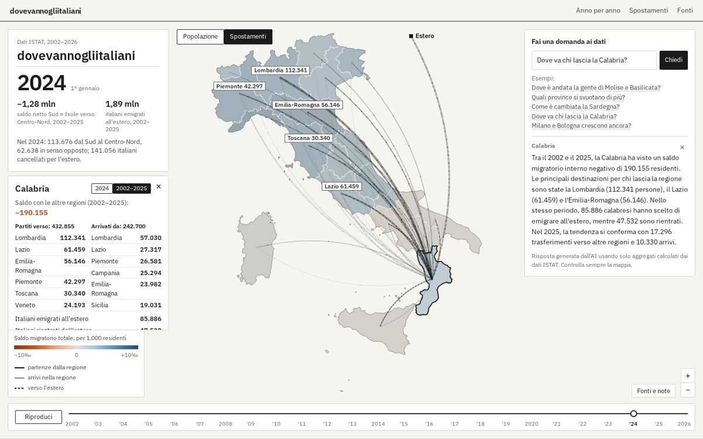
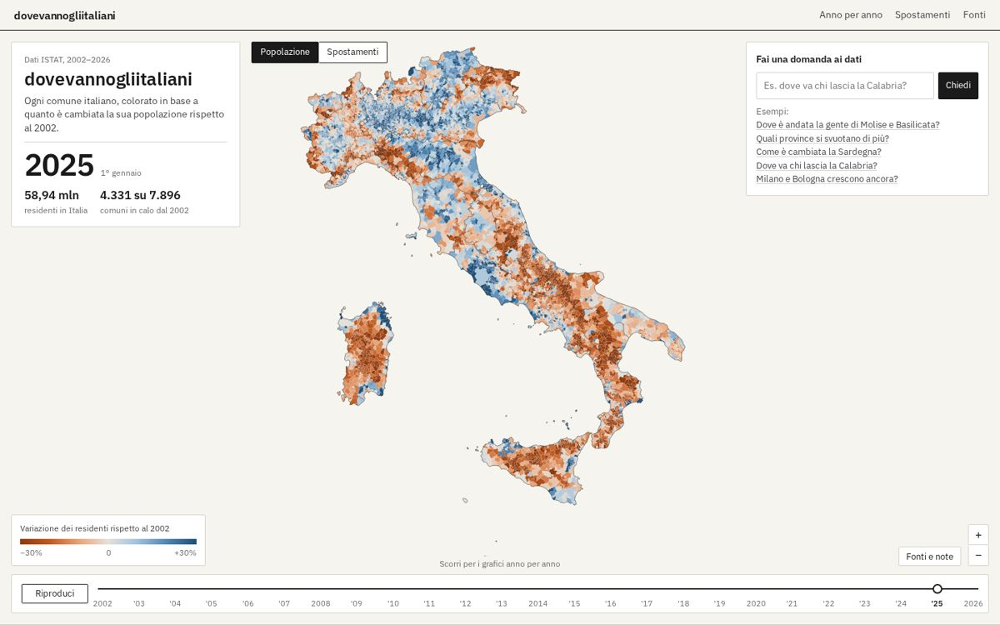

# Dove vanno gli italiani · L'Italia che si svuota

Mappa animata dei Comuni italiani dal 2002 a oggi: chi si svuota, chi cresce e dove vanno le persone, tra regioni e verso l'estero. Dati ISTAT, con domande in linguaggio naturale all'AI.

**Live:** https://italia-che-si-svuota.vercel.app



## Cosa fa

**Modalità "Popolazione"**
- Mappa di tutti i 7.896 Comuni (confini al 1° gennaio 2026), colorati per variazione % dei residenti rispetto al 2002 (rosso = calo, blu = crescita).
- Timeline 2002–2026 con play/pausa e animazione fluida tra un anno e l'altro.
- Passando sopra (o toccando) un Comune: residenti, variazione e sparkline dell'andamento. I Comuni nati da fusioni includono i Comuni d'origine.

**Modalità "Spostamenti"**
- Archi animati con particelle tra le regioni: arancione Sud → Centro-Nord, azzurro Centro-Nord → Sud, viola italiani verso l'estero. Spessore e densità delle particelle sono proporzionali ai trasferimenti.
- Le regioni sono colorate per saldo migratorio totale (interno + estero) per 1.000 residenti; i flussi seguono l'anno della timeline.
- Clic su una regione: dove sono andati i suoi residenti, da dove arrivano i nuovi, saldo, italiani emigrati e rientrati dall'estero (per anno o per tutto il 2002–2025).
- Numeri di testata: saldo netto Sud e Isole verso Centro-Nord 2002–2025 (−1,28 milioni) e italiani emigrati all'estero 2002–2025 (1,89 milioni).

**Chiedi ai dati (AI)**
- Domande in italiano, es. "Dove va chi lascia la Calabria?" o "Come è cambiata la Sardegna?".
- Una funzione serverless (`api/ask.js`, Vercel AI SDK + AI Gateway, modello economico) riceve solo aggregati calcolati dai file ISTAT; ogni numero della risposta viene verificato contro questi dati e, se non torna, si usa una risposta a modello deterministica. La mappa si sposta sull'area o passa agli spostamenti della regione citata.



## Fonti dei dati (tutte ISTAT)

| Dato | Fonte | Anni |
|---|---|---|
| Residenti per Comune al 1° gennaio | [Ricostruzione della popolazione intercensuaria](https://demo.istat.it/app/?i=RIC&l=it) | 2002–2019 |
| Residenti per Comune al 1° gennaio | [POSAS – Popolazione residente](https://demo.istat.it/app/?i=POS&l=it) | 2020–2025, 2026 stima |
| Confini comunali, provinciali, regionali (generalizzati) | [Confini delle unità amministrative](https://www.istat.it/storage/cartografia/confini_amministrativi/generalizzati/2026/Limiti01012026_g.zip) | 1/1/2026 |
| Variazioni amministrative e Comuni soppressi | [Codici dei Comuni](https://www.istat.it/storage/codici-unita-amministrative/Variazioni-amministrative-e-territoriali-dal-1991.zip) | dal 1991 |
| Trasferimenti di residenza: matrice origine-destinazione tra regioni, emigrati/immigrati con l'estero, paesi di destinazione | esploradati.istat.it, dataflow `28_185_DF_DCIS_MIGRAZIONI_{1,4,6,7}` ([tavole](https://demo.istat.it/tavole/?l=it&t=apr4)) | 2002–2025, 2025 provvisorio |

## Avvertenze

- Tutti i dati di popolazione sono riportati sui confini al 1/1/2026: le fusioni sommano i Comuni d'origine, i cambi di codice e provincia (es. Sardegna) sono ricondotti al Comune attuale.
- Misiliscemi (TP) nasce nel 2021 da Trapani: non ha dati prima del 2022 e il calo di Trapani nel 2022 è in parte dovuto al distacco.
- Tra 2019 (ricostruzione) e 2020 (dati post-censimento permanente) può esserci una piccola discontinuità.
- ISTAT pubblica la matrice origine-destinazione solo tra **regioni**: gli archi collegano i centri geografici delle regioni, non le città. Gli spostamenti interni a una regione sono esclusi; il Trentino-Alto Adige è una regione unica.
- Sono cambi di residenza anagrafica: l'emigrazione reale all'estero è probabilmente più alta, perché non tutti si cancellano dall'anagrafe. Per il 2026 non ci sono ancora dati sui flussi.
- Le risposte AI sono generate da un modello: i numeri sono controllati contro gli aggregati, la formulazione no.

## Struttura

```
index.html, src/          frontend statico (Vite, d3, canvas)
public/data/              dati precalcolati serviti come file statici (~3,5 MB)
api/ask.js                unica funzione serverless (AI)
api/_data/                aggregati letti dalla funzione AI (~0,6 MB)
scripts/fetch_raw.sh      scarica i dati grezzi ISTAT in raw/ (non versionata)
scripts/build_data.py     popolazione → public/data/pop.json + api/_data/aggregates.json, comuni_index.json
scripts/build_flows.py    trasferimenti → public/data/flows.json + api/_data/flows_agg.json
```

## Sviluppo locale

Serve Node 22+ (consigliato 24) e Python 3.

```bash
npm install
npm run dev          # solo frontend su http://localhost:5173 (l'AI non risponde)
```

Per provare anche `/api/ask` in locale: `vercel link` al progetto, `vercel env pull .env.local` (token OIDC per AI Gateway) e poi `vercel dev`.

## Rigenerare i dati da ISTAT

```bash
npm install                 # installa anche mapshaper
npm run data:fetch          # scarica ed estrae in raw/ (~900 MB, non versionata)
npm run data:build          # rigenera public/data/*.json e api/_data/*.json
```

## Deploy

Il progetto Vercel **non** è collegato a questo repository (nessuna integrazione Git, nessuna build automatica sui push, per contenere i costi). Il deploy si fa a mano dalla CLI, compilando in locale:

```bash
vercel build --prod
vercel deploy --prebuilt --prod
```

Tutto il sito è statico tranne `api/ask.js`; su Vercel c'è anche una regola firewall di rate limit su `/api/ask` (10 richieste/minuto per IP).
